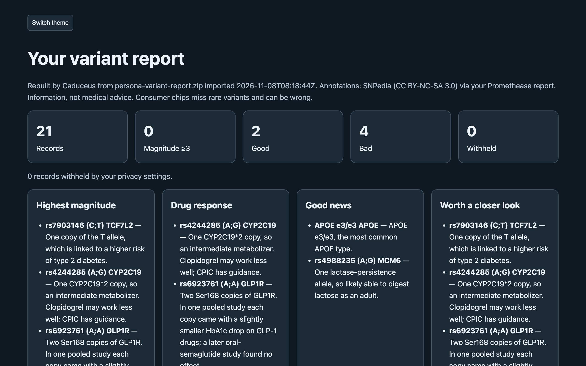
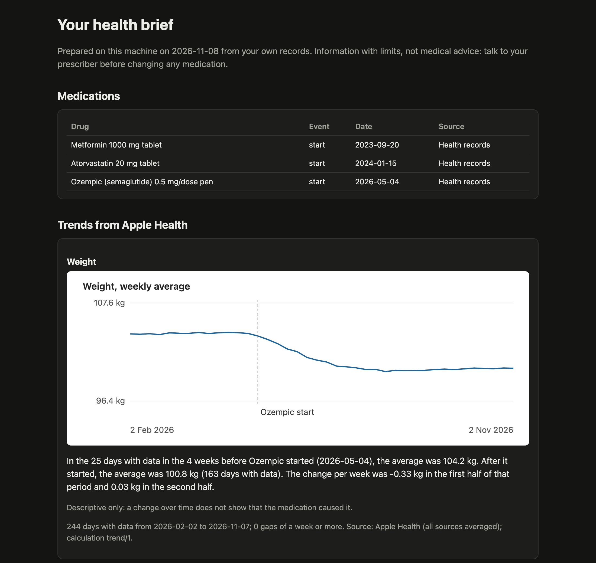

# Caduceus: Personalized Health & DNA AI


Health answers that cite your own DNA, Apple Health and records, plus new research, from a vault on your machine.

[](https://github.com/electricsheephq/caduceus/releases/latest)
[](LICENSE)
[](https://github.com/NousResearch/hermes-agent)
[](https://github.com/electricsheephq/caduceus/actions/workflows/ci.yml)

> Information with limits, not medical advice. Caduceus never tells you to start, stop or change a medication.

## Install

```bash
hermes plugins install electricsheephq/caduceus --enable
```

It needs Hermes Agent 0.23.0 or newer and nothing else: no API keys, no extra packages. Restart Hermes, then try the
demo below. To use your own files, tell your agent **"set up Caduceus"**. The setup skill takes you through:
1. importing your files;
2. recording your medications;
3. choosing a privacy level;
4. turning on the research watch.

Caduceus is also in the Hermes plugin catalog. Installing it by name (`hermes plugins install caduceus --enable`) needs a
Hermes that can read the current catalog ([hermes-agent#151856](https://github.com/NousResearch/hermes-agent/issues/151856));
the line above always works. Without `--enable`, Hermes installs the plugin switched off; `hermes plugins enable caduceus`
turns it on.

## Try it

1. Install with the line above and restart Hermes.
2. Type `/caduceus demo`. Caduceus writes three files for an invented person and imports them in about a minute:
   - a DNA raw-data file;
   - a variant report;
   - an Apple Health export with health records.

   The demo loads only into an empty vault, so it never mixes with your own data.
3. Ask *"Why isn't my Ozempic working?"*. One answer comes back, and each part names its source:
   - **Apple Health:** weight fell about 0.3 kg a week for three months after the recorded semaglutide start, then levelled off.
   - **Health records:** HbA1c went from 8.4% to 7.8%, still above the reference range.
   - **Genome:** one GLP1R marker is flagged. Its evidence is small and mixed: one 2023 study found an effect, and a 2026 study found none. The answer also cites the 2026 *Nature* study on GLP-1 weight loss.
   - **Next step:** bring these numbers to the prescriber.

   Then try *"Would Mounjaro be different for me?"*.

## What you get

Caduceus brings these into one SQLite vault on your own machine:
- your 23andMe, AncestryDNA, MyHeritage, FamilyTreeDNA or Living DNA raw data;
- your Promethease report;
- your Apple Health export;
- your US health records.

What that gives you:
- **One answer from all your data:** your genotype, your weight curve, your lab results and published research, each cited.
- **Your vault stays on your machine:** search, imports and reports run locally. The agent reads only the slices a question needs.
- **Your variant report, rebuilt offline:** your Promethease report becomes a self-contained page in Caduceus' own design. Caduceus also writes a one-page health brief with charts to bring to your doctor.
- **It keeps watching new research about your genes and medications:** studies on your own gene–drug pairs come first, and a digest arrives only when something new appears.

| Your variant report, rebuilt offline | A one-page brief for your doctor |
|---|---|
|  |  |

*The screenshots use the synthetic demo persona, not a real person's data.*

## How it compares

| | Stock Hermes (attached files and memory) | Caduceus |
|---|---|---|
| A DNA raw-data file (600,000 lines or more) | Too big to read whole; the agent sees slices of raw text | Imported once; any marker is looked up in milliseconds |
| An Apple Health export | Too big to read whole | Daily trends with units and coverage gaps |
| Where your data lives | Chat attachments and memory notes | One SQLite vault on your machine |
| Gene–drug checks | The model's general knowledge | CPIC guidance plus GLP-1 research, each cited with its evidence level |
| Before and after a medication start | No | A trend comparison around the start date |
| New research | No | A research watch on your own gene–drug pairs |

Other health plugins in the Hermes catalog read Apple Health, records or medications. When Caduceus launched in November
2026, none of them read DNA raw data or watched research.

## What it reads

| File | How to get it |
|---|---|
| 23andMe raw data (v3, v4, v5), `.zip` or `.txt` | Request your raw data download in your 23andMe settings |
| AncestryDNA raw data, `.zip` | Download your DNA data in your AncestryDNA settings |
| MyHeritage raw data, `.zip` or `.csv` | Download your raw DNA data in your MyHeritage DNA settings |
| FamilyTreeDNA Family Finder raw data, `.csv.gz` | Family Finder → download raw data (the build 37 file) |
| Living DNA raw data, `.zip` or `.txt` | Download your raw data in your Living DNA settings |
| Promethease report, `.zip` or `.html` | The report file you downloaded from Promethease |
| Apple Health export: the `.zip` from an iPhone in any language, or the export XML inside it | iPhone Health app → your picture → Export All Health Data. With Health Records connected, the zip includes your clinical records |
| FHIR R4 JSON (labs, conditions, medications) | A patient portal's FHIR or "download my record" export |

Give your agent the file's path, and Caduceus copies the file into its vault and imports it.
- The agent is told never to open these files itself.
- Big imports keep running in the background, and re-importing a file does nothing.
- An interrupted import resumes where it stopped.
- A vault holds one person. A second DNA file is compared with the first on shared markers, and if it looks like a
  different person, you are told, and answers carry a warning. Keep each person in their own Hermes profile.

## Tools

| Tool | What it does |
|---|---|
| `caduceus_search` | Full-text search across your annotations, research, labs, conditions, medications and notes, with cited snippets; lists everything of one kind, such as your medications |
| `caduceus_genome` | Your genotype at any marker, gene views, gene–drug checks (CPIC guidance plus GLP-1 research), derived calls (APOE, CYP2C19, CYP2C9 and others), a gene–drug profile, top findings, and the rebuilt variant report |
| `caduceus_trend` | Apple Health trends with units, coverage gaps and a calculation version; before and after a medication start; lab results over time; a daily signal check |
| `caduceus_capture` | Imports and their progress, medications (recorded only after you confirm), notes, the research watch, settings, and the health brief |

A gene–drug result keeps three outcomes apart:
- **flag:** you carry the effect allele;
- **no flag:** it was tested and is absent;
- **not assessed:** not on your chip, or a no-call.

"Not assessed" is never reported as normal.

## Privacy

| Level | What shows |
|---|---|
| `open` (default) | Everything you imported, except categories you hide |
| `standard` | Alzheimer's risk (APOE), hereditary cancer risk, carrier status, mental health and reproductive results stay hidden until you unlock each one |

You change these yourself, with `/caduceus privacy standard`, `/caduceus hide <category>`, `/caduceus unlock <category>`
and so on (`/caduceus help` lists them), or in the plugin settings. Your agent can read the settings but cannot change
them. Hidden results are counted, never described.

Disclosure — imports, search and reports run locally, and the vault is never uploaded as a
whole; tool results (slices of your data) enter the conversation, so the model provider you
chose sees them; the research watch (on by default, runs when you or the agent ask for it or on a schedule you
create, off with the `research_watch` setting) sends gene and topic terms, the names of medications you recorded,
and public marker and article IDs, never genotypes, to Europe PMC and NCBI; scheduled checks run model turns billed
like any message;
no telemetry. Includes a report-a-problem skill: the agent drafts a bug report, asks you to
check it holds no health data, and files it to this repository with `gh` only after you
approve the draft.

Your data lives in your Hermes profile's `plugin-data/caduceus/`. In v0.1 it is not encrypted at rest; encrypted and local-model levels are planned for v0.4. See [SECURITY.md](SECURITY.md) for the boundaries.

## Settings

| Setting | Default | What it does |
|---|---|---|
| `privacy_level` | `open` | `open` or `standard` (see Privacy above) |
| `hidden_categories` | none | Categories never shown at any level |
| `unlocked_categories` | none | Sensitive categories you chose to see at `standard` |
| `research_watch` | on | Lets research-watch runs query Europe PMC and NCBI with gene, drug and topic terms. Genotypes are never sent |
| `research_topics` | none | Topics to watch besides your genes and medications |
| `vault_hint` | on | Adds the short fixed note to the first health question of each chat (see Accuracy and limits) |

Change them in the plugin settings, or for privacy with `/caduceus` commands.

## Where it works

| Surface | Status |
|---|---|
| Hermes CLI | Tested: imports by path, `/caduceus` commands, questions |
| Hermes Desktop | Tested with the demo: attach a file or give its path |
| Messaging apps (Telegram and others) | Not tested yet. Questions should work in any chat with your agent. Telegram caps files at 20 MB, so import big exports from the CLI or Desktop by path |

## Research watch and daily check

- **`/blueprint caduceus:research-watch`:**
  - **What it does:** a digest of new studies (Europe PMC, LitVar2) and ClinVar changes about your genes, medications and chosen topics, weekly by default.
  - **First run:** 3 studies to start with. Studies on your own gene–drug pairs come first (for example GLP1R and semaglutide, from the last five years), then papers that mention your markers, then general results. Each item says why it was picked.
  - **After that:** only new ones, in the same order, and nothing when there is nothing new.
  - **What it sends:** gene and topic words, the names of medications you recorded, marker IDs from the built-in knowledge pack, and article IDs. Which terms it sends depends only on your medications and topics, never on your genotypes.
  - **When it runs:** when you or your agent ask for it, or on the schedule the blueprint creates. It is on by default; the `research_watch` setting turns it off.
- **`/blueprint caduceus:daily-check`:** once a day, checks your Apple Health trends (resting heart rate, sleep, weight, steps) and messages you only when something is outside its threshold. It costs one model call a day.

## Accuracy and limits

- **Chips miss things.** Consumer DNA chips test common variants. Rare variants can be missed or miscalled: in one large study, most rare pathogenic chip calls did not confirm. Anything important needs a clinical test.
- **Some genes can't be read from chips.** CYP2D6, HLA types and copy-number changes are reported as *not assessed*. An ambiguous APOE pattern stays ambiguous.
- **Small effects, labelled evidence.** Genetic effects on drug response are usually small. Every result carries its evidence level (a CPIC guideline, or research association), its sources and its limits.
- **No medical advice.** Caduceus never tells you to start, stop or change a medication. Talk to your prescriber.
- **A reminder for every model.** The first health, medication or DNA question in each chat carries one short fixed note for the model: answer from your vault's tools, and leave medication decisions to your prescriber. It keeps smaller models from answering from general knowledge. The note holds none of your data; the `vault_hint` setting turns it off.

## Data sources and licences

- **CPIC:** gene–drug guidance data, CC0.
- **NCBI:** ClinVar, dbSNP and LitVar2 (public).
- **Europe PMC:** article metadata.
- **SNPedia:** its text (CC BY-NC-SA 3.0) appears only from your own Promethease report. Caduceus keeps it on your machine, labels it, and never ships or fetches it.

## Development

Python 3.11+, standard library only.

```bash
python -m pip install pytest
python -m pytest
```

Tests use synthetic data generated at test time and never touch the network. Module contracts are in
[docs/contracts.md](docs/contracts.md), agent guidance in [AGENTS.md](AGENTS.md), and how to contribute in
[CONTRIBUTING.md](CONTRIBUTING.md).

## Troubleshooting

| Problem | What to do |
|---|---|
| `hermes plugins install caduceus` can't find it | Use `hermes plugins install electricsheephq/caduceus --enable` |
| The `caduceus_*` tools don't show up | Run `hermes plugins enable caduceus`, then restart Hermes |
| An import seems stuck | Big Apple Health exports take a few minutes and keep running in the background. Ask your agent for the import status |
| "That path cannot be read" | Caduceus refuses credential files and other profiles' secrets. Give the path of the export itself |
| `/caduceus demo` refuses to load | It loads only into an empty vault. Try it in a fresh Hermes profile |
| The agent answers without citing your data | Keep the `vault_hint` setting on, or say "use Caduceus" in your question |

## Report a bug

- **Bugs:** use the [bug form](https://github.com/electricsheephq/caduceus/issues/new?template=bug_report.yml). Your agent can draft it: ask it to "report a problem with Caduceus". Never put health data in a report; describe the problem with the demo persona's data instead.
- **Security or privacy problems:** [report them privately](https://github.com/electricsheephq/caduceus/security/advisories/new) (see [SECURITY.md](SECURITY.md)).

[Releases](https://github.com/electricsheephq/caduceus/releases) · [CHANGELOG](CHANGELOG.md) · [CONTRIBUTING](CONTRIBUTING.md) · [LICENSE](LICENSE)

## Licence

Apache-2.0. Made by [Electric Sheep](https://github.com/electricsheephq) for Hermes Agent.
